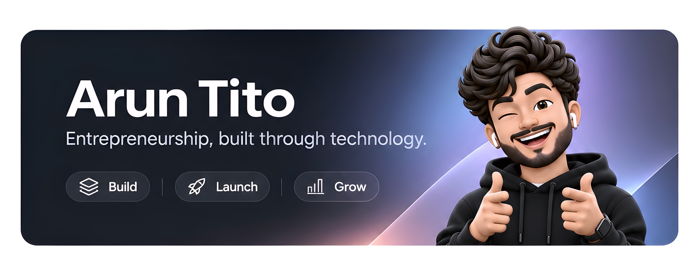
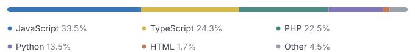

  

Building independent ventures across software, AI, and digital business. Focused on turning ambitious ideas into well-crafted products and enduring businesses.

---

## <picture><source media="(prefers-color-scheme: dark)" srcset="https://api.iconify.design/lucide/compass.svg?color=%23FFFFFF"></picture> Approach

**Ideas into products. Products into businesses.**

I bring together product thinking, engineering, and business execution to build ventures from the ground up.

From software and AI to digital platforms, I focus on creating products that are useful, intuitive, and built to scale.

## <picture><source media="(prefers-color-scheme: dark)" srcset="https://api.iconify.design/lucide/layers.svg?color=%23FFFFFF"></picture> Ventures

### <picture><source media="(prefers-color-scheme: dark)" srcset="https://api.iconify.design/lucide/chart-no-axes-combined.svg?color=%23FFFFFF"></picture> <a href="https://github.com/aruntito/doob-v2">DOOB</a>

Growth intelligence for creators.

### <picture><source media="(prefers-color-scheme: dark)" srcset="https://api.iconify.design/lucide/network.svg?color=%23FFFFFF"></picture> <a href="https://github.com/aruntito/karadavi">KARADAVI</a>

A connected knowledge platform for exploring the world.

### <picture><source media="(prefers-color-scheme: dark)" srcset="https://api.iconify.design/lucide/megaphone.svg?color=%23FFFFFF"></picture> <a href="https://github.com/aruntito/smxm">SMXM</a>

Digital marketing and growth systems.

### <picture><source media="(prefers-color-scheme: dark)" srcset="https://api.iconify.design/lucide/share-2.svg?color=%23FFFFFF"></picture> <a href="https://github.com/aruntito/smmly">SMMLY</a>

A platform for social media marketing.

### <picture><source media="(prefers-color-scheme: dark)" srcset="https://api.iconify.design/lucide/briefcase-business.svg?color=%23FFFFFF"></picture> <a href="https://github.com/aruntito/titora">TITORA</a>

A home for business and technology ventures.

### <picture><source media="(prefers-color-scheme: dark)" srcset="https://api.iconify.design/lucide/ice-cream-cone.svg?color=%23FFFFFF"></picture> <a href="https://github.com/aruntito/creamery">Tito’s Creamery</a>

A food and beverage venture.

---

## Most used languages

  

---

## <picture><source media="(prefers-color-scheme: dark)" srcset="https://api.iconify.design/lucide/at-sign.svg?color=%23FFFFFF"></picture> Connect with me

  <a href="https://aruntito.com" title="Website"><picture><source media="(prefers-color-scheme: dark)" srcset="https://api.iconify.design/lucide/globe.svg?color=%23FFFFFF"></picture></a>&nbsp;&nbsp;&nbsp;
  <a href="https://www.linkedin.com/in/arundharavath" title="LinkedIn"><picture><source media="(prefers-color-scheme: dark)" srcset="https://api.iconify.design/simple-icons/linkedin.svg?color=%23FFFFFF"></picture></a>&nbsp;&nbsp;&nbsp;
  <a href="https://www.instagram.com/arun.tito" title="Instagram"><picture><source media="(prefers-color-scheme: dark)" srcset="https://api.iconify.design/simple-icons/instagram.svg?color=%23FFFFFF"></picture></a>&nbsp;&nbsp;&nbsp;
  <a href="https://x.com/aruntito" title="X"><picture><source media="(prefers-color-scheme: dark)" srcset="https://api.iconify.design/simple-icons/x.svg?color=%23FFFFFF"></picture></a>&nbsp;&nbsp;&nbsp;
  <a href="https://www.youtube.com/@aruntito" title="YouTube"><picture><source media="(prefers-color-scheme: dark)" srcset="https://api.iconify.design/simple-icons/youtube.svg?color=%23FFFFFF"></picture></a>&nbsp;&nbsp;&nbsp;
  <a href="https://orcid.org/0009-0002-9335-8812" title="ORCID"><picture><source media="(prefers-color-scheme: dark)" srcset="https://api.iconify.design/simple-icons/orcid.svg?color=%23FFFFFF"></picture></a>&nbsp;&nbsp;&nbsp;
  <a href="mailto:hey@aruntito.com" title="Email"><picture><source media="(prefers-color-scheme: dark)" srcset="https://api.iconify.design/lucide/mail.svg?color=%23FFFFFF"></picture></a>

---

*Thoughtfully made. Purposefully built.*

