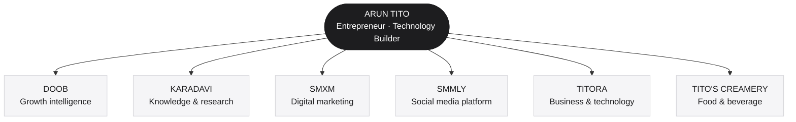

# Arun Tito

**Entrepreneur · Technology Builder**

I build products, software, and digital systems—bringing ideas into clear, useful experiences through thoughtful engineering and execution.

[Website](https://trydoob.in) · [LinkedIn](https://www.linkedin.com/in/arundharavath) · [Instagram](https://www.instagram.com/arun.tito/) · [X](https://x.com/aruntito_) · [Email](mailto:thearuntito@gmail.com)

---

## Ventures

[DOOB](https://github.com/aruntito/doob-v2) · [KARADAVI](https://github.com/aruntito/karadavi) · [SMXM](https://github.com/aruntito/smxm) · [SMMLY](https://github.com/aruntito/smmly) · [TITORA](https://github.com/aruntito/titora) · [Tito’s Creamery](https://github.com/aruntito/creamery)

---

## Technology

---

*Thoughtful technology. Purposeful products. Built to last.*
